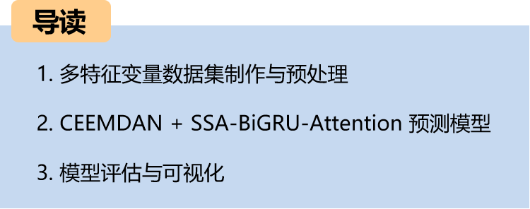
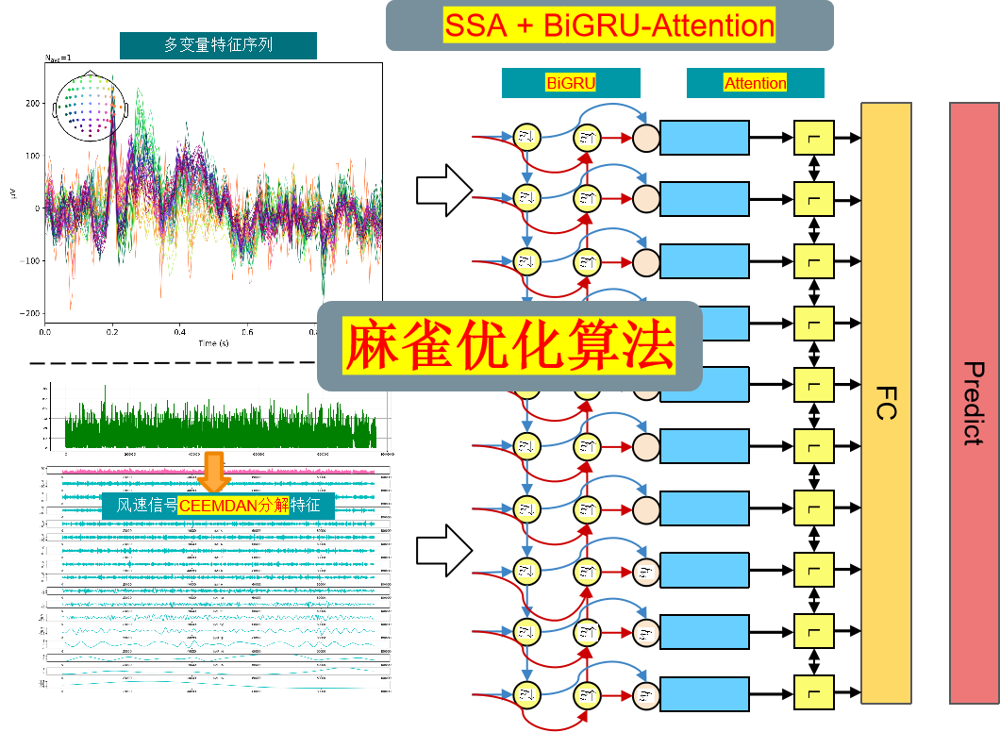
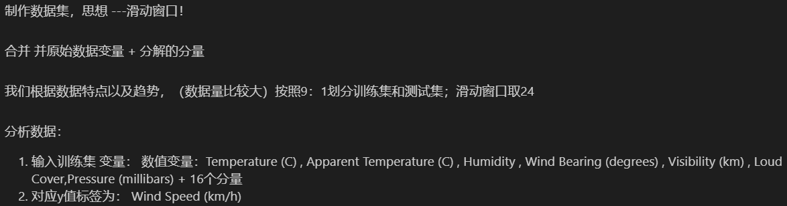
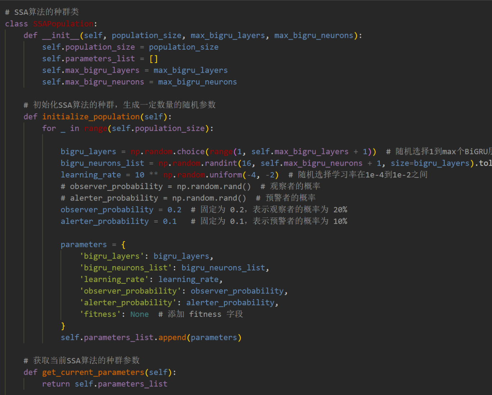
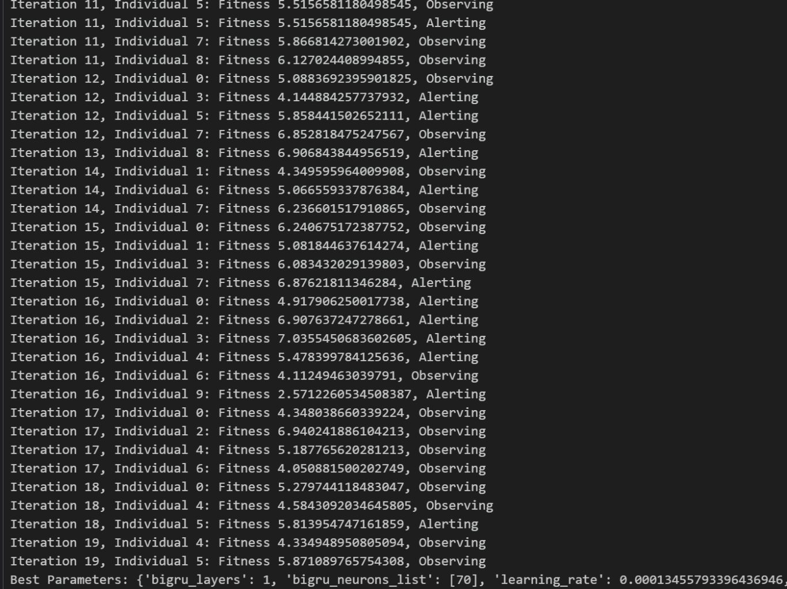
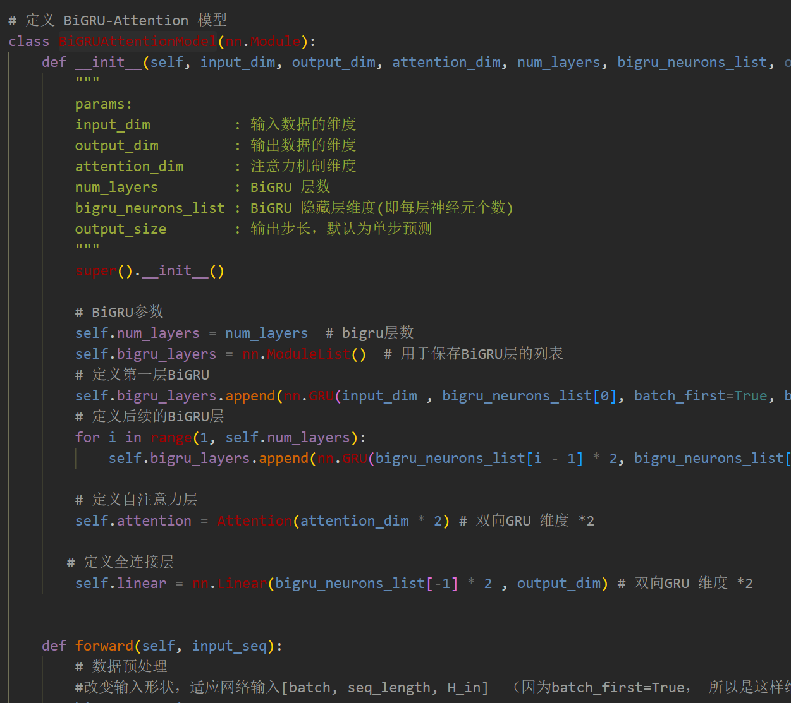
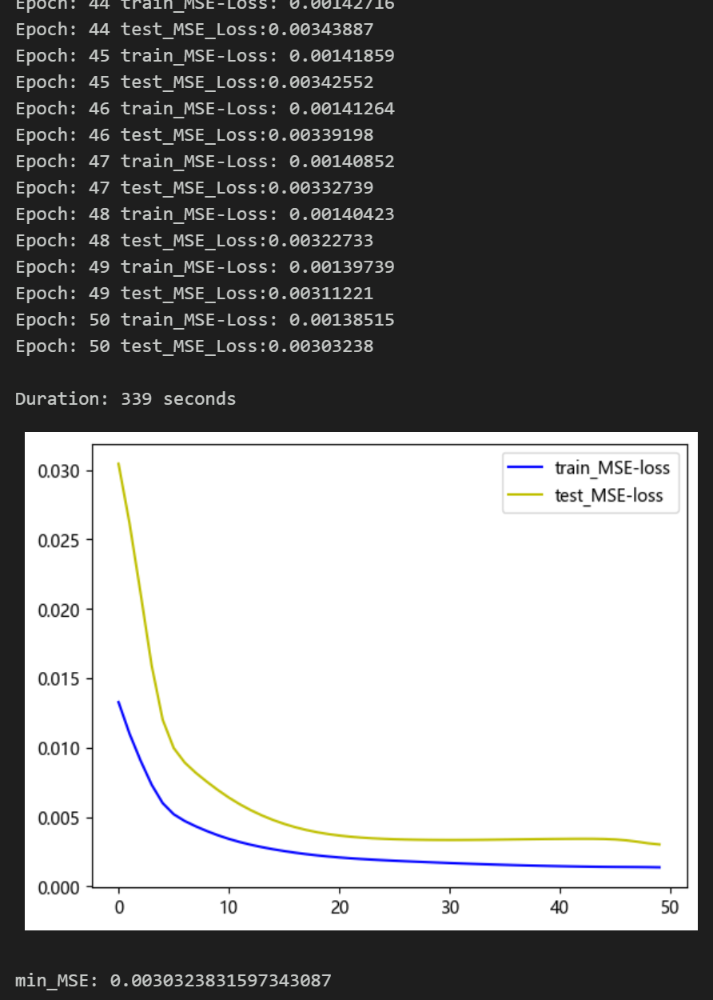
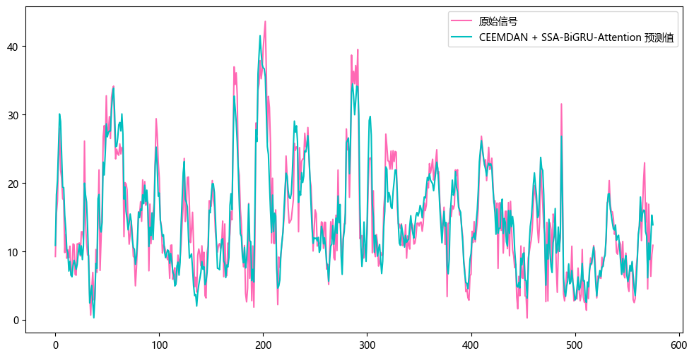
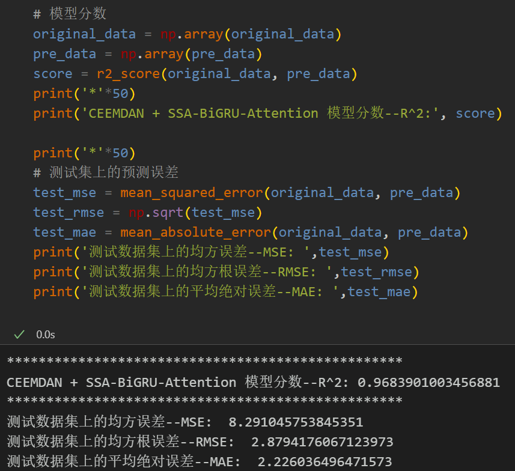
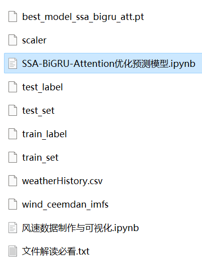

# Multi-feature Variable Sequence Prediction (9) CEEMDAN-SSA-BiGRU-Attention Prediction Model Based on Sparrow Optimization Algorithm

Including wind speed data, as well as the already generated and prepared wind speed dataset and label set, corresponding codes can be run.
The CEEMDAN+SSA-BiGRU-Attention model has smaller MSE and MAE, with particularly noticeable performance enhancements!
This includes preprocessing code for data and CEEMDAN decomposition code, as well as complete CEEMDAN+SSA-BiGRU-Attention model prediction and visualization code.
\n        \n  
1. Introduction
This paper introduces a comprehensive application of the Complete Ensemble Empirical Mode Decomposition (CEEMDAN) with the Sparse Attention mechanism and the Sparse Attention-based Self-GRU-Attention (SSA-BiGRU-Attention) model for multi-feature variable sequence prediction, aiming to enhance the predictive performance of time series data.

2. Model Architecture
The dataset consists of nine variables: weather, temperature, humidity, pressure, and wind speed. The CEEMDAN algorithm is used to decompose the wind speed sequence, then all components are combined with the original dataset variables to form an enhanced feature input. A sliding window is created to create the dataset, and multivariate prediction is performed using the wind speed. The SSA-BiGRU-Attention model is optimized by the Sparrow Optimization Algorithm to extract the enhanced features, which are then fed into the fully connected layer to achieve a high-precision prediction model.

3. Multi-Feature Variable Dataset Preparation and Preprocessing
3.1 Data Import
3.2 CEEMDAN Decomposition
3.3 Dataset Preparation and Preprocessing
Firstly, the original data variables and the decomposed components are merged, and the training set and test set are divided at a ratio of 9:1.
3.4 Dataset Creation
3.5 Sparrow Optimization Algorithm
3.5.1 Introduction to Sparrow Optimization Algorithm
The Sparrow Optimization Algorithm (SOA), also known as Sparrow Optimization Algorithm, is an optimization algorithm based on the characteristics of bird behavior in nature. It simulates the optimization strategies of birds in foraging, migration, and social interactions. This algorithm demonstrates good performance in solving various optimization problems.
The basic idea of the Sparrow Optimization Algorithm is to optimize the solution in the search space through mimicking the foraging behavior of birds. The process can be divided into three stages: foraging behavior, migration behavior, and social behavior.
1. Foraging Behavior: Sparrows select food sources that are closer and have higher adaptability when foraging. In the algorithm, each individual in the solution space is considered a food source with an adaptability evaluation value. Sparrows seek out better solutions by selecting individuals with higher adaptability.
2. Migration Behavior: When sparrows search around a food source for a certain period without finding a better solution, they will choose to leave the current food source and head to other food sources to continue searching. In the algorithm, the position information between individuals will change to simulate the migration behavior of sparrows.
3. Social Behavior: Sparrows obtain more information through communication with other sparrows while foraging, which helps improve their foraging efficiency. In the algorithm, individuals exchange information to enhance their solutions and update the optimal solution in the solution space.
\t3.2 Python-based Sparrow Optimization Algorithm Implementation
\t3.3 Sparrow Optimization Algorithm - Superparameter Optimization Process
The Sparrow Optimization Algorithm has the characteristics of simplicity, easy implementation, global optimization capability, and self-adaptability, making it suitable for solving combinatorial optimization problems. We use the Sparrow Optimization Algorithm to optimize the hyperparameters of the SSA-BiGRU-Attention model.
By setting an appropriate population size and number of optimization iterations, we search for the optimal parameters within the given hyperparameter range.
3. Pytorch-based CEEMDAN + SSA-BiGRU-Attention Prediction Model
\t3.1 Define the CEEMDAN + SSA-BiGRU-Attention Prediction Model
\tNote: The input wind speed data shape is [64, 7, 23], batch_size=64, where 7 represents the sequence length (the sliding window takes values), and the dimension 23 represents the dimensions of the selected 8 variables and 15 components.
3.2 Setting parameters and training the model
50 epochs, MSE is 0.003032. The prediction performance of multivariate features CEEMDAN + SSA-BiGRU-Attention is good. After adding CEEMDAN decomposition, the prediction performance of multivariate data has been significantly improved, with superior performance. By appropriately adjusting model parameters, further improvement in model prediction performance can be achieved.
Note: Adjust parameters as needed:
Modify the population size and optimization iterations of the bird optimization algorithm;
Adjust the parameter search range for BiGRU layers, layer dimensions, and attention dimension numbers to increase more epochs (be cautious to prevent overfitting);
Change the sliding window length (set an appropriate window length)
4 Model evaluation and visualization
4.1 Results visualization
4.2 Model evaluation

## Images

<!-- PAYMENT_BLOCK -->

## Get this dataset

- Payment link (Stripe): [Buy now](https://buy.stripe.com/3cs8yP7sY87d0vu9AB)
- Payment QR code: 

<!-- /PAYMENT_BLOCK -->
